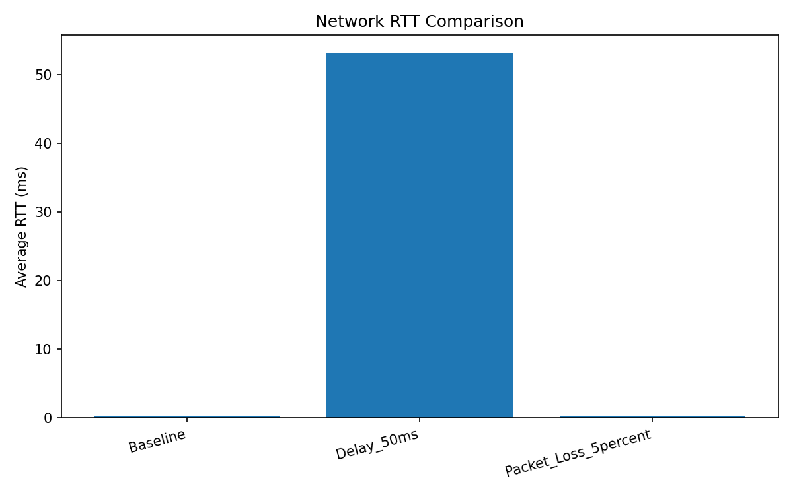
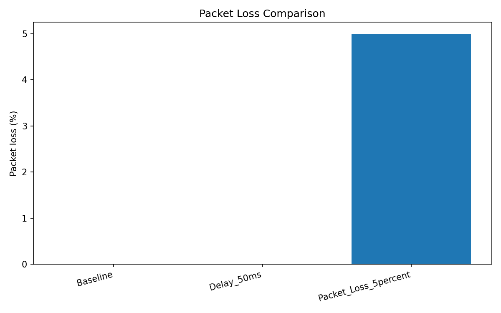
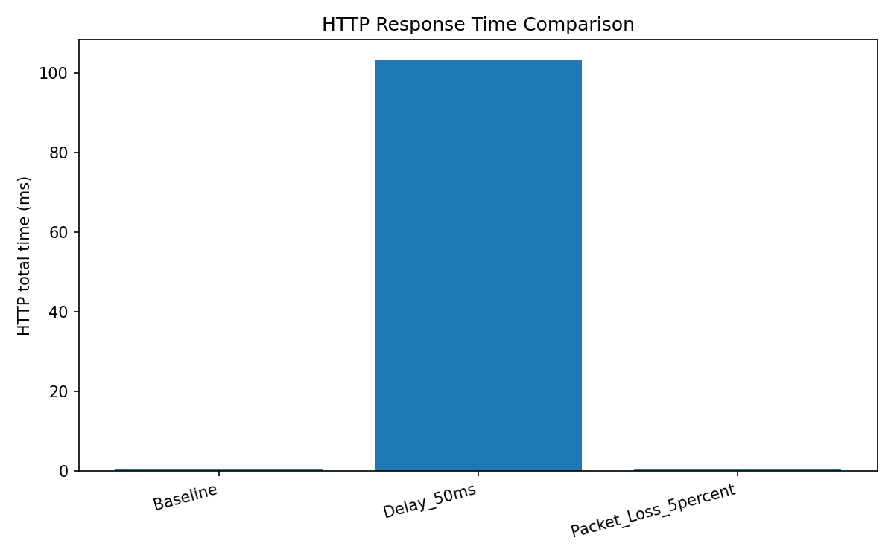

# Network Deployment, Measurement, and Observability

## 1. Project Overview
This project implements a virtual network using Linux network namespaces,
virtual Ethernet interfaces, routing, and a Docker-based Nginx application server.

The network path is:

UE -> Access -> Core -> App -> Nginx application server

## 2. Network Configuration

| Component | Interface | IP address |
|---|---|---|
| UE | veth-ue | 10.0.1.2/24 |
| Access | veth-access1 | 10.0.1.1/24 |
| Access | veth-access2 | 10.0.2.1/24 |
| Core | veth-core1 | 10.0.2.2/24 |
| Core | veth-core2 | 10.0.3.1/24 |
| App | veth-app | 10.0.3.2/24 |
| App | veth-apphost | 172.18.0.10/16 |
| Nginx | Docker container | 172.18.0.2/16 |

## 3. Application Server
The application server uses the official Nginx Docker image.
The HTTP service listens on port 80 inside the container and is also
published on host port 8080.

The UE successfully accessed Nginx at http://172.18.0.2 and received
HTTP status 200 OK.

## 4. Packet Capture
The file ue_http.pcap contains a TCP/HTTP capture from the UE interface.
It includes the TCP handshake, HTTP HEAD request, HTTP 200 OK response,
and connection closure.

## 5. Performance Results

| Scenario | Average RTT | Packet loss | HTTP total time |
|---|---:|---:|---:|
| Baseline | 0.285 ms | 0% | 0.527 ms |
| 50 ms delay | 53.135 ms | 0% | 103.298 ms |
| 5% packet loss | 0.294 ms | 5% | 0.485 ms |
### Performance Graphs

The following graphs compare the network performance under baseline, delay, and packet-loss conditions.

**Average Round-Trip Time (RTT)**

**Packet Loss Comparison**

**HTTP Response Time Comparison**

### Analysis of Results

- **Baseline:** The average RTT was 0.285 ms, with no packet loss. The HTTP request completed in 0.527 ms.
- **50 ms delay:** The average RTT increased to 53.135 ms. HTTP total time increased to 103.298 ms because the added network delay affected communication between the UE and the application server.
- **5% packet loss:** The 100-packet ICMP test recorded 5% packet loss. The tested HTTP request still returned status 200 OK, with a measured total time of 0.485 ms. This single HTTP measurement does not establish how packet loss affects HTTP performance over repeated tests.

TCP throughput measured between UE and App was 113 Gbit/s in the virtual
environment, with zero reported TCP retransmissions.

UDP throughput was 10 Mbit/s, receiver jitter was 0.003 ms, and the
receiver reported zero lost datagrams out of 8637.

## 6. Generated Files
- results.csv: recorded experiment measurements
- plot_results.py: Python script used to generate graphs
- rtt_comparison.png: RTT comparison
- packet_loss_comparison.png: packet-loss comparison
- http_time_comparison.png: HTTP response-time comparison
- ue_http.pcap: captured TCP/HTTP packets

## 7. Conclusions
The virtual network successfully routed traffic from the UE through the
Access and Core namespaces to the Nginx application server.

The baseline test showed low RTT and no packet loss. Adding 50 ms delay
increased RTT and HTTP response time. Applying 5% packet loss produced
5% measured loss in the 100-packet ICMP test, while the tested HTTP request
still returned status 200 OK.

The throughput results describe this virtual test environment and should
not be interpreted as the capacity of a physical network link.
